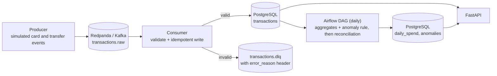
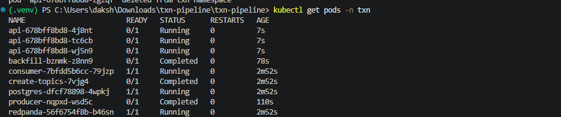
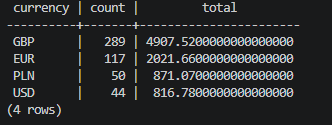
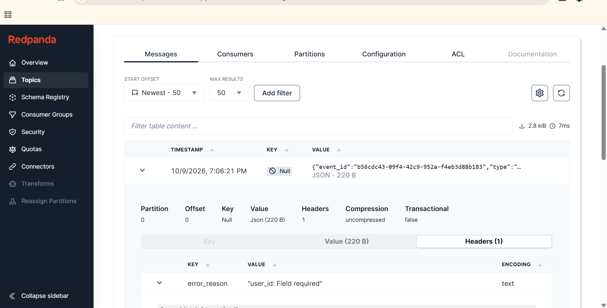
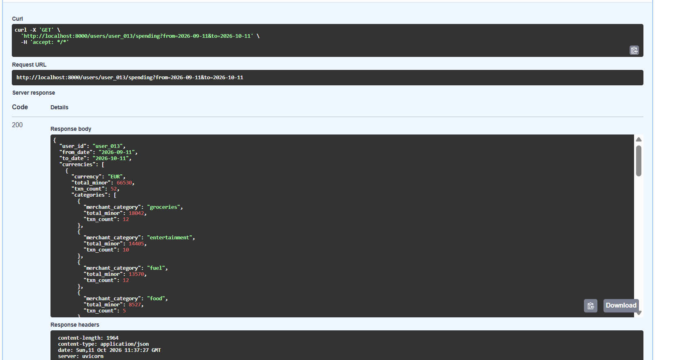
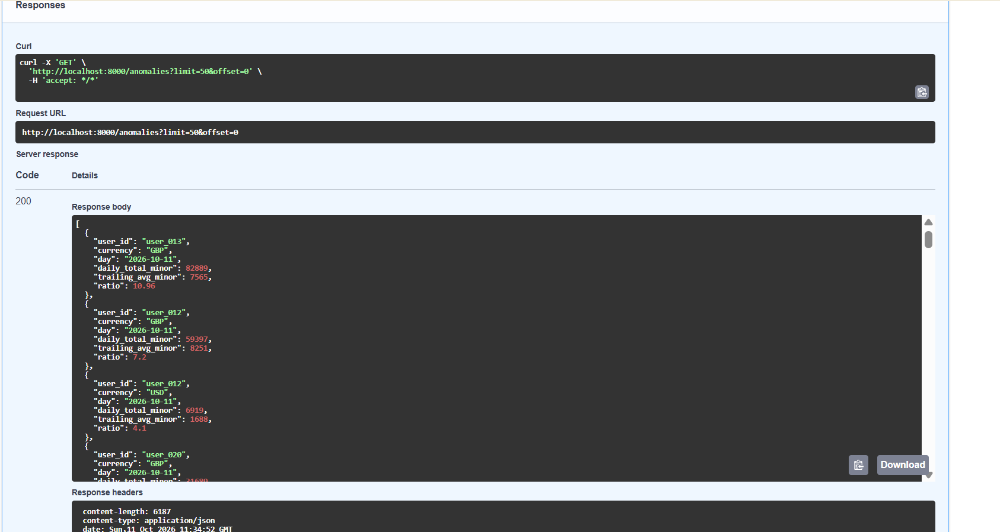
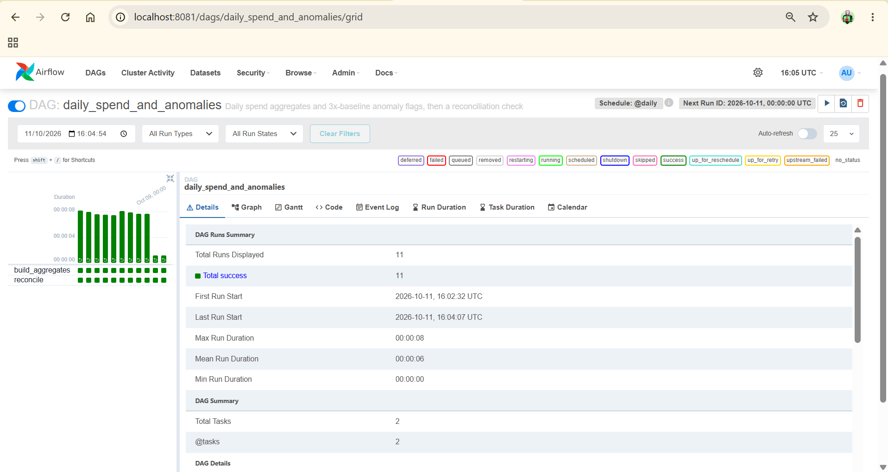
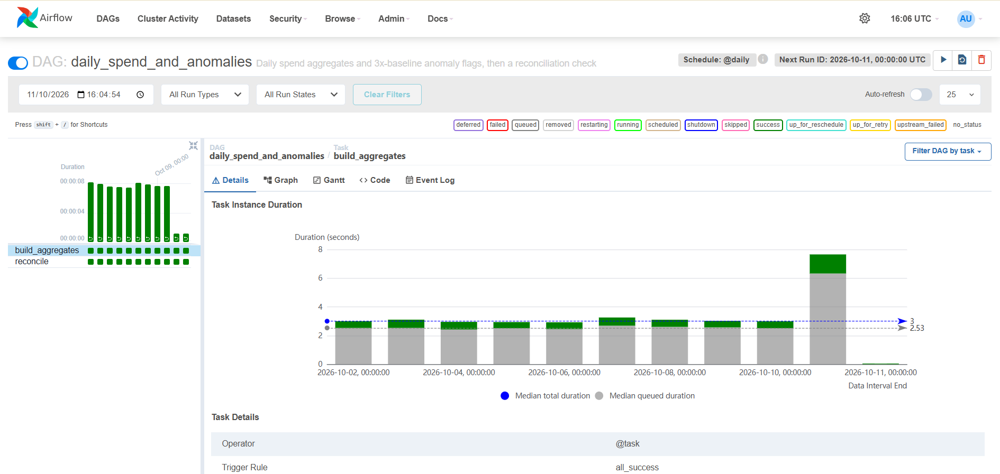
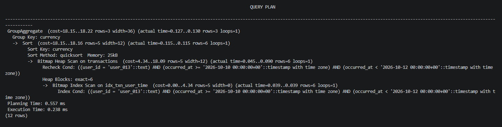

# txn-pipeline

An event-driven transaction pipeline for a mock payments app. It ingests simulated card and
transfer events through Kafka, validates and stores them idempotently in PostgreSQL, builds daily
spend aggregates with a simple anomaly rule, and serves the results through a REST API.

**Stack:** Python 3.12 · Redpanda (Kafka-compatible) · PostgreSQL · Apache Airflow · FastAPI · pytest · Docker Compose · GitHub Actions

> **Status:** ingestion, validation, daily aggregation, anomaly detection, the Airflow DAG and the
> REST API are built and tested. Containerising the consumer and API is next (see [Roadmap](#roadmap)).

## Architecture



## What it does

1. **Producer** (`producer/simulate.py`) generates card and transfer events across several
   currencies. It deliberately injects ~2% duplicates, ~2% malformed messages and occasional large
   purchases, so the failure paths and the anomaly rule can be demonstrated.
2. **Consumer** (`consumer/main.py`) validates each event, writes valid ones to PostgreSQL
   idempotently, and routes invalid ones to a dead-letter topic with the failure reason attached.
3. **Batch job** (`pipeline/job.py`) computes daily spend per user, currency and merchant category,
   and flags days where a user's spend is more than 3x their trailing 30-day average. An **Airflow
   DAG** (`dags/daily_spend_dag.py`) runs it daily, then a reconciliation task checks that the
   aggregates add up to the raw transactions and fails the run if they do not.
4. **API** (`api/`) exposes spending and anomaly data over REST.

## Quick start

Requires Docker Desktop and Python 3.11 or 3.12. (The newest Python releases may not have
prebuilt `confluent-kafka` wheels yet.)

```powershell
git clone https://github.com/DakshSohanlal/txn-pipeline.git
cd txn-pipeline
python -m venv .venv
.venv\Scripts\Activate.ps1          # macOS/Linux: source .venv/bin/activate
pip install -r requirements-dev.txt
copy .env.example .env              # macOS/Linux: cp .env.example .env

docker compose up -d                # Redpanda, Redpanda Console (localhost:8080), PostgreSQL
docker compose exec redpanda rpk topic create transactions.raw transactions.dlq
pytest tests/unit                   # run the test suite
```

### Run the pipeline

```powershell
# terminal 1: start the consumer
python -m consumer.main

# terminal 2: generate events (5,000 events, ~0.5% large purchases)
python -m producer.simulate --count 5000 --rate 500 --spike-rate 0.005

# when the consumer has caught up, compute aggregates and anomalies (adjust the date)
python -m pipeline.job --day 2026-10-11 --backfill 28

# start the API, then open http://localhost:8000/docs
uvicorn api.main:app --reload
```

### Airflow

`docker compose up -d` also builds and starts Airflow (needs about 2 GB of RAM; run
`docker compose stop airflow` to free it). The UI is at http://localhost:8081, user `admin`.

```powershell
# password for the admin user
docker compose exec airflow cat /opt/airflow/standalone_admin_password.txt

# check the DAG parsed, then run one day end to end without the scheduler
docker compose exec airflow airflow dags list-import-errors
docker compose exec airflow airflow dags test daily_spend_and_anomalies 2026-10-11

# backfill a range of days
docker compose exec airflow airflow dags backfill -s 2026-10-01 -e 2026-10-11 daily_spend_and_anomalies
```

The DAG has two tasks: `build_aggregates` runs the batch job for the run's day, and `reconcile`
compares `daily_spend` with the raw transactions per currency and fails the run on any difference.

### Kubernetes

The `k8s/` folder has manifests that run the whole pipeline on a local cluster (tested on
Docker Desktop's built-in Kubernetes): Postgres, Redpanda, the consumer, and two replicas of the
API with readiness and liveness probes, all with resource requests and limits. A CronJob runs the
daily aggregation; Airflow is not deployed to the cluster, so the CronJob covers scheduling there.

```powershell
docker build -t txn-pipeline:local .
kubectl apply -f k8s/00-namespace.yaml
kubectl create configmap postgres-schema --from-file=schema.sql=db/schema.sql -n txn
kubectl apply -f k8s/
kubectl create -f k8s/optional/producer-job.yaml        # generate events
kubectl create -f k8s/optional/backfill-job.yaml        # build aggregates (edit the dates first)
kubectl port-forward svc/api 8000:8000 -n txn           # then open http://localhost:8000/docs
```



## API

| Endpoint | Description |
|---|---|
| `GET /health` | Liveness check |
| `GET /users/{user_id}/spending?from=YYYY-MM-DD&to=YYYY-MM-DD` | Spend for a user, grouped by currency then merchant category. Both dates are inclusive (UTC). Max range 366 days. |
| `GET /anomalies?day=&user_id=&limit=&offset=` | Flagged days, highest ratio first. `limit` 1-200 (default 50). |

Interactive documentation is generated at `/docs`.

## Demo

**PostgreSQL after ingesting 500 unique events.** Duplicates were ignored and malformed events
never reached the table.



**Dead-letter topic.** Each rejected message keeps its original payload and an `error_reason` header.



**`GET /users/{id}/spending`** returns spend grouped by currency and category.



**`GET /anomalies`** returns days where spend exceeded 3x the user's trailing average.







## Design decisions

- **Money is stored as integer minor units** (pence, cents), never floats, so there is no rounding drift.
- **Idempotent ingestion.** `event_id` is the primary key and inserts use `ON CONFLICT DO NOTHING`,
  so a duplicate or replayed message is harmless.
- **At-least-once delivery.** The consumer commits the Kafka offset only after the database commit
  succeeds. A crash can cause a re-delivery, never a loss, and idempotent writes absorb the repeat.
- **Bad data does not block the stream.** Invalid events go to `transactions.dlq` with the reason
  in a header, so they can be inspected and replayed.
- **Logic is separated from I/O.** Validation, aggregation and anomaly detection are pure
  functions with no Kafka, database or HTTP code, which makes them fast to unit test. The job and
  API depend on small interfaces (`Store`, `Repository`), so tests use in-memory fakes.
- **The Airflow DAG is a thin wrapper.** All logic lives in `pipeline/` and is unit tested without
  Airflow; the DAG only schedules it and passes in the run's logical day. Tasks are safe to retry
  and re-run because the job replaces results rather than appending.
- **Reconciliation as a data-quality gate.** After each build, per-currency totals and counts from
  `daily_spend` are compared with the raw `transactions` for the same UTC day. Any difference fails
  the run with no retries, since the data disagrees and a person needs to look.
- **The batch job is idempotent.** Each run replaces the 30-day window in `daily_spend` and the
  target day in `anomalies`, in one transaction, so re-running a day or backfilling never duplicates
  rows, and late-arriving events are picked up on the next run.
- **Indexes match the queries.** `(user_id, occurred_at)` serves the spending endpoint,
  `occurred_at` serves the batch job's window scan, and `anomalies(day)` serves the anomalies endpoint.
- **All SQL is parameterised.** The only interpolated parts are fixed column names.

**Index check.** `EXPLAIN ANALYZE` on the spending query for one user over two days uses
`idx_txn_user_time` (bitmap index scan, about 0.2 ms) instead of scanning the table.



### Anomaly rule

For each `(user, currency)`, a day is flagged if its total spend is **strictly more than 3x** the
average daily spend over the previous 30 days.

- Currencies are never summed together, since that needs FX rates.
- Days are UTC calendar days.
- The baseline averages the user's *active* days (days with at least one transaction) and excludes
  the day being tested.
- A user needs at least 5 active days of history, otherwise they are skipped to avoid false alarms.
- The comparison uses integer arithmetic, so there are no floating-point edge cases at the boundary.

## Testing

```powershell
ruff check .
pytest tests/unit --cov=consumer --cov=pipeline --cov=api
```

Unit tests cover event validation, aggregation, anomaly detection, the batch job (against a fake
store) and the API (against a fake repository). They were written test-first. GitHub Actions runs
lint and tests on every push.

Integration tests run against a real PostgreSQL (docker compose up -d postgres, then pytest tests/integration); CI runs them against a Postgres service container.

## Project structure

```
txn-pipeline/
├── producer/       simulate.py          event generator
├── consumer/       models, validate, db, main
├── pipeline/       aggregates, anomalies, reconcile, job, store
├── dags/           daily_spend_dag.py   Airflow DAG
├── airflow/        Dockerfile           Airflow image with the Postgres driver
├── api/            main, schemas, service, repository
├── db/             schema.sql
├── tests/unit/     validation, aggregation, anomalies, reconciliation, job, API
├── docs/           screenshots
├── docker-compose.yml
└── .github/workflows/ci.yml
```

## Known limitations

- The batch job loads a 30-day window into Python and aggregates there. This is fine at demo scale;
  at real volume the `GROUP BY` would move into SQL.
- The API opens one database connection per request. A connection pool would be the next step.
- Airflow runs in `standalone` mode with a SQLite metadata database and the sequential executor.
  That is fine for a demo and resets when the container is recreated; production would use a
  Postgres metadata database and a LocalExecutor, Celery or Kubernetes executor. The DAG targets
  Airflow 2.11; moving to Airflow 3 is a one-line import change (`airflow.sdk`).
- There is no authentication, and all data is simulated.
- A single consumer process is used. Scaling out means more partitions and consumers in one group.

## Roadmap

- [x] Airflow DAG to schedule the daily job, with a reconciliation check
- [x] Run the consumer and API as containers, so `docker compose up` starts everything
- [x] Integration tests against a real PostgreSQL instance
- [x] Kubernetes manifests (kind or minikube) for the API and consumer
