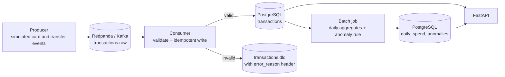

# txn-pipeline

An event-driven transaction pipeline for a mock payments app. It ingests simulated card and
transfer events through Kafka, validates and stores them idempotently in PostgreSQL, builds daily
spend aggregates with a simple anomaly rule, and serves the results through a REST API.

**Stack:** Python 3.12 · Redpanda (Kafka-compatible) · PostgreSQL · FastAPI · pytest · Docker Compose · GitHub Actions

> **Status:** ingestion, validation, daily aggregation, anomaly detection and the REST API are
> built and tested. Airflow scheduling is next (see [Roadmap](#roadmap)).

## Architecture



## What it does

1. **Producer** (`producer/simulate.py`) generates card and transfer events across several
   currencies. It deliberately injects ~2% duplicates, ~2% malformed messages and occasional large
   purchases, so the failure paths and the anomaly rule can be demonstrated.
2. **Consumer** (`consumer/main.py`) validates each event, writes valid ones to PostgreSQL
   idempotently, and routes invalid ones to a dead-letter topic with the failure reason attached.
3. **Batch job** (`pipeline/job.py`) computes daily spend per user, currency and merchant category,
   and flags days where a user's spend is more than 3x their trailing 30-day average.
4. **API** (`api/`) exposes spending and anomaly data over REST.

## Quick start

Requires Docker Desktop and Python 3.11 or 3.12. (The newest Python releases may not have
prebuilt `confluent-kafka` wheels yet.)

```powershell
git clone https://github.com/DakshSohanlal/txn-pipeline.git
cd txn-pipeline
python -m venv .venv
.venv\Scripts\Activate.ps1          # macOS/Linux: source .venv/bin/activate
pip install -r requirements-dev.txt
copy .env.example .env              # macOS/Linux: cp .env.example .env

docker compose up -d                # Redpanda, Redpanda Console (localhost:8080), PostgreSQL
docker compose exec redpanda rpk topic create transactions.raw transactions.dlq
pytest tests/unit                   # run the test suite
```

### Run the pipeline

```powershell
# terminal 1: start the consumer
python -m consumer.main

# terminal 2: generate events (5,000 events, ~0.5% large purchases)
python -m producer.simulate --count 5000 --rate 500 --spike-rate 0.005

# when the consumer has caught up, compute aggregates and anomalies (adjust the date)
python -m pipeline.job --day 2026-10-11 --backfill 28

# start the API, then open http://localhost:8000/docs
uvicorn api.main:app --reload
```

## API

| Endpoint | Description |
|---|---|
| `GET /health` | Liveness check |
| `GET /users/{user_id}/spending?from=YYYY-MM-DD&to=YYYY-MM-DD` | Spend for a user, grouped by currency then merchant category. Both dates are inclusive (UTC). Max range 366 days. |
| `GET /anomalies?day=&user_id=&limit=&offset=` | Flagged days, highest ratio first. `limit` 1-200 (default 50). |

Interactive documentation is generated at `/docs`.

## Demo

**PostgreSQL after ingesting 500 unique events.** Duplicates were ignored and malformed events
never reached the table.


**Dead-letter topic.** Each rejected message keeps its original payload and an `error_reason` header.


**`GET /users/{id}/spending`** returns spend grouped by currency and category.


**`GET /anomalies`** returns days where spend exceeded 3x the user's trailing average.


## Design decisions

- **Money is stored as integer minor units** (pence, cents), never floats, so there is no rounding drift.
- **Idempotent ingestion.** `event_id` is the primary key and inserts use `ON CONFLICT DO NOTHING`,
  so a duplicate or replayed message is harmless.
- **At-least-once delivery.** The consumer commits the Kafka offset only after the database commit
  succeeds. A crash can cause a re-delivery, never a loss, and idempotent writes absorb the repeat.
- **Bad data does not block the stream.** Invalid events go to `transactions.dlq` with the reason
  in a header, so they can be inspected and replayed.
- **Logic is separated from I/O.** Validation, aggregation and anomaly detection are pure
  functions with no Kafka, database or HTTP code, which makes them fast to unit test. The job and
  API depend on small interfaces (`Store`, `Repository`), so tests use in-memory fakes.
- **The batch job is idempotent.** Each run replaces the 30-day window in `daily_spend` and the
  target day in `anomalies`, in one transaction, so re-running a day or backfilling never duplicates
  rows, and late-arriving events are picked up on the next run.
- **Indexes match the queries.** `(user_id, occurred_at)` serves the spending endpoint,
  `occurred_at` serves the batch job's window scan, and `anomalies(day)` serves the anomalies endpoint.
- **All SQL is parameterised.** The only interpolated parts are fixed column names.

### Anomaly rule

For each `(user, currency)`, a day is flagged if its total spend is **strictly more than 3x** the
average daily spend over the previous 30 days.

- Currencies are never summed together, since that needs FX rates.
- Days are UTC calendar days.
- The baseline averages the user's *active* days (days with at least one transaction) and excludes
  the day being tested.
- A user needs at least 5 active days of history, otherwise they are skipped to avoid false alarms.
- The comparison uses integer arithmetic, so there are no floating-point edge cases at the boundary.

## Testing

```powershell
ruff check .
pytest tests/unit --cov=consumer --cov=pipeline --cov=api
```

Unit tests cover event validation, aggregation, anomaly detection, the batch job (against a fake
store) and the API (against a fake repository). They were written test-first. GitHub Actions runs
lint and tests on every push.

## Project structure

```
txn-pipeline/
├── producer/       simulate.py          event generator
├── consumer/       models, validate, db, main
├── pipeline/       aggregates, anomalies, job, store
├── api/            main, schemas, service, repository
├── db/             schema.sql
├── tests/unit/     validation, aggregation, anomalies, job, API
├── docs/           screenshots
├── docker-compose.yml
└── .github/workflows/ci.yml
```

## Known limitations

- The batch job loads a 30-day window into Python and aggregates there. This is fine at demo scale;
  at real volume the `GROUP BY` would move into SQL.
- The API opens one database connection per request. A connection pool would be the next step.
- There is no authentication, and all data is simulated.
- A single consumer process is used. Scaling out means more partitions and consumers in one group.
- There are no integration tests against a real database yet. The unit tests use fakes, which is how
  a missing-commit bug in the batch job's Postgres layer got past them and was found by running it.

## Roadmap

- [ ] Airflow DAG to schedule the daily job
- [ ] Integration tests against a real PostgreSQL instance
- [ ] Kubernetes manifests (kind or minikube) for the API and consumer
- [ ] GCP deployment (Cloud Run for the API, or load aggregates into BigQuery)
